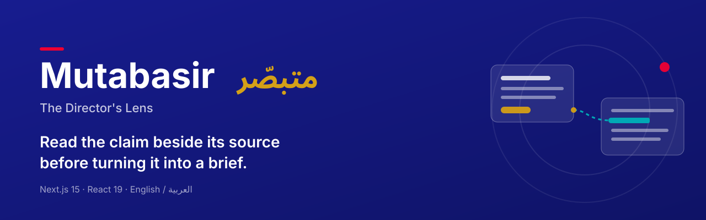
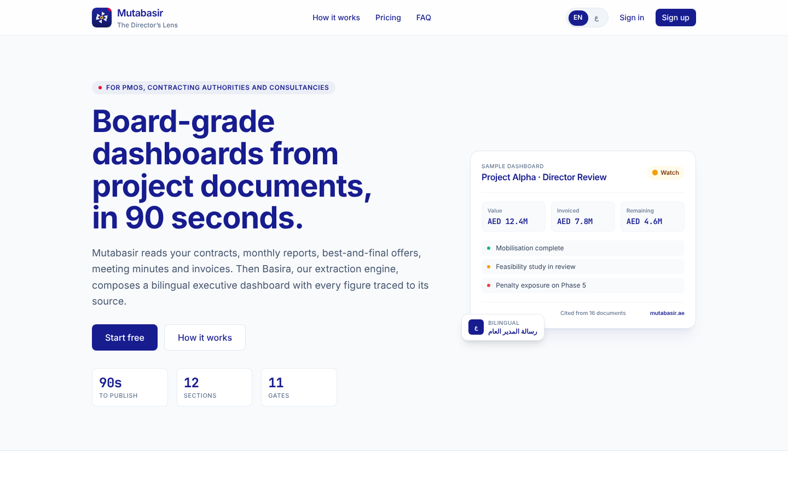
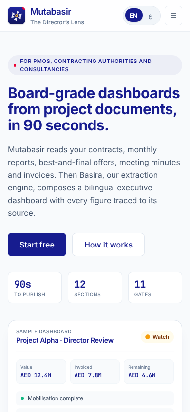
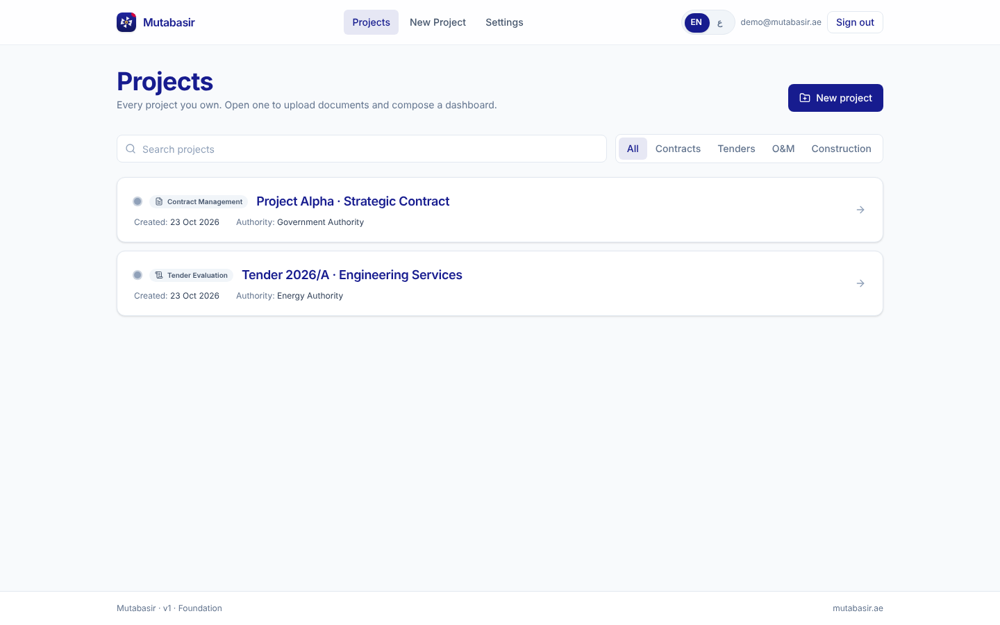
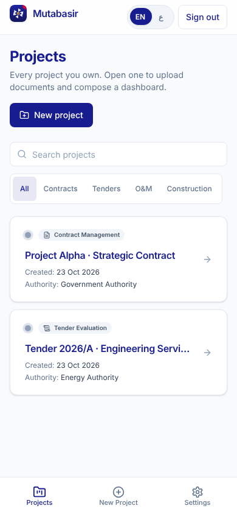
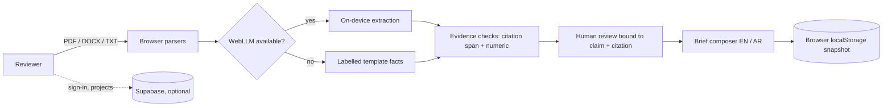

<p align="center">
  
</p>

<p align="center"><br><sub><em>Concept image (AI-generated). Not a product screenshot.</em></sub></p>

<p align="center"><strong>Read the claim beside its source before turning it into a brief.</strong></p>

<p align="center">
  
  
  
  
  
  
  
</p>

<p align="center">
  <a href="#overview">Overview</a> ·
  <a href="#key-features">Features</a> ·
  <a href="#screenshots">Screenshots</a> ·
  <a href="#quick-start">Quick start</a> ·
  <a href="#deploy-on-vercel">Deploy</a> ·
  <a href="#status-and-known-limitations">Status</a> ·
  <a href="#ملخص-بالعربية">العربية</a>
</p>

## Overview

Mutabasir (متبصّر) helps executives and reviewers inspect document-derived
claims, compare their citations with the source text, and prepare bilingual
briefs. Its useful unit is a claim a person can check, not a confident-looking
summary.

**Document → Parsed text → Proposed claims → Source inspection → Human review → Brief**

## Key features

| Your task | What the code does | Important boundary |
| --- | --- | --- |
| Read source documents | Browser-side PDF, DOCX, TXT and MD parsing. Nothing is uploaded to a server. | Supported parsing does not guarantee every page or table is correct |
| Inspect a proposed claim | Side-by-side evidence, source-span matching and numeric checks | Lexical/numeric consistency is not semantic truth |
| Review the evidence | Explicit local human review bound to the current claim and citation | Local review is not authenticated organizational approval |
| Prepare a brief | English/Arabic output, copy and Markdown export | Template output is visibly marked unverified and cannot pass reviewed publication |
| Keep a readable snapshot | Local snapshots and a print-oriented published view | Pipeline storage is local to the browser, not a durable cloud evidence record |
| Manage projects | Project list with text search, subject filters and a live result count | Without Supabase, projects live in a cookie-backed demo store |

Other working pieces:

- Full English and Arabic interface with RTL layout and a locale toggle.
- Optional on-device extraction through WebLLM on WebGPU browsers. Without it,
  the app falls back to clearly labelled template facts.
- Supabase sign-in and project CRUD when the Supabase variables are set.
- Demo mode when they are not set, so the app builds and runs without secrets.
- Installable PWA shell, `/api/health` endpoint, sitemap and robots routes.

## Screenshots

Captured from a local production build in demo mode (no Supabase), after
loading the built-in sample projects. The sample projects are synthetic.

| Desktop (1440 × 900) | Mobile (390 × 844) |
| --- | --- |
|  |  |
|  |  |

## Quick start

Quality CI uses Node.js 22 and the committed npm lockfile.

```bash
git clone https://github.com/ahmadzayan-hub/mutabasir.git
cd mutabasir
npm ci
npm run dev
```

Open **http://localhost:3000**. With no `.env.local` the app runs in demo mode:
sign-in is simulated and projects are stored in a browser cookie. Use
**Load sample projects** on `/projects` to try the workflow with synthetic data.

To connect a real backend, copy the example file and fill in values for an
approved development project only:

```bash
cp .env.example .env.local
```

Keep `.env.local` private. Real project sign-in needs the correct Supabase URL,
public key and schema. Database migration access is separate and must never be
bundled into a browser asset.

The extraction path uses optional on-device WebLLM. It needs a compatible WebGPU
browser and an explicit model load/download. When unavailable, the fallback
produces labelled templates, not verified source findings. Adding an Anthropic
key from the example file only changes a status indicator on the Settings page.
It does not make the browser path a server-hosted extraction workflow.

Do not run `npm run db:apply` against production as a quick-start step. It writes
schema state, and the repository contains more than one initial-schema file.
Inspect compatibility, existing data and the migration ledger first; verify a
backup and isolated restore. See [the repository guide](docs/REPOSITORY_GUIDE.md).

## Scripts

| Command | Purpose |
| --- | --- |
| `npm run dev` | Start the development server on port 3000 |
| `npm run build` | Production build |
| `npm run start` | Serve the production build |
| `npm run lint` | ESLint through `next lint` |
| `npm run typecheck` | TypeScript check with `tsc --noEmit` |
| `npm test` | Vitest suite (single run) |
| `npm run test:watch` | Vitest in watch mode |
| `npm run db:apply` | Apply SQL schema using `DATABASE_URL` from `.env.local` (see warning above) |

## Project structure

```text
src/
  app/
    _landing/            public landing page sections
    (auth)/              sign-in and sign-up
    (app)/projects/      project list, detail pipeline, published view
    (app)/new/           new project form and sample-project seeding
    (app)/settings/      settings and self-test panel
    api/health/          health check route
  components/            UI kit, evidence split view, motion, branding
  lib/
    parsers/ llm/ extraction/   document parsing and optional local inference
    evidence/ brief/            claim/source rules and brief composition
    store/                      local pipeline store and Supabase store
    i18n/                       English and Arabic dictionary
  middleware.ts          Supabase session refresh and route gating
supabase/                migrations and storage bucket definitions
docs/                    architecture, safety, testing and release documents
```

## Architecture



The evidence pipeline runs in the browser. Supabase holds auth and project
records only when configured. See [Architecture](docs/ARCHITECTURE.md) and
[EVIDENCE_SAFETY.md](EVIDENCE_SAFETY.md) for the full contract.

## Evidence and human review

- Mock/template facts start as **LOW / TEMPLATE / NOT EVIDENCE**. They cannot
  pass the reviewed publication gate.
- A claim needs an available exact citation, compatible numeric values and an
  explicit human review tied to its unchanged claim/citation payload.
- Citation matching does not verify meaning, units, dates or the conclusion.
  A person must compare the claim with the source.
- Edits, missing sources, stale reviews and legacy flags fail closed.
- After reload, sources must be re-extracted and reviewed. Old local snapshots
  remain readable with a permanent non-operational notice.
- These browser checks are safeguards, not protection against someone editing
  their own `localStorage`.

## Deploy on Vercel

The repository includes a verified `vercel.json`. The build succeeds with no
environment variables set; the app then runs in demo mode.

| Setting | Value |
| --- | --- |
| Framework preset | Next.js |
| Root directory | `.` (repository root) |
| Install command | `npm install` (from `vercel.json`) |
| Build command | `next build` |
| Output directory | `.next` |
| Node.js version | 22.x (matches CI) |

Environment variables (all optional for a demo deploy):

| Variable | Scope | Used for |
| --- | --- | --- |
| `NEXT_PUBLIC_SUPABASE_URL` | Browser + server | Enables Supabase auth and project storage |
| `NEXT_PUBLIC_SUPABASE_ANON_KEY` | Browser + server | Supabase public key |
| `NEXT_PUBLIC_APP_URL` | Browser + server | Canonical URL for metadata, sitemap and robots |
| `SUPABASE_SERVICE_ROLE_KEY` | Server only | Listed in `.env.example`; never expose to the browser |
| `ANTHROPIC_API_KEY` | Server only | Only shown as configured/not configured on Settings |
| `NEXT_PUBLIC_DEFAULT_THEME` | Browser | Listed in `.env.example` |
| `DATABASE_URL` | Local only | `npm run db:apply`; do not add to Vercel |

More detail: [docs/DEPLOY.md](docs/DEPLOY.md) and
[docs/DEPLOYMENT_AND_ROLLBACK.md](docs/DEPLOYMENT_AND_ROLLBACK.md).

## Status and known limitations

The source is [`ahmadzayan-hub/mutabasir`](https://github.com/ahmadzayan-hub/mutabasir),
branch `main`. Earlier references to a `desktop-tutorial` branch are historical.

The 23 October 2026 integration at `8f21c4a00310a0de2539a8326bc2cd79b88f3904`
passed **96 tests across 12 files**, TypeScript, lint and a production build.
[Exact integrated CI result](https://github.com/ahmadzayan-hub/mutabasir/actions/runs/40004384708)

**The full durable evidence workflow is not implemented by configuration alone.**

- Supabase-backed sign-in and project CRUD exist. Documents, facts, briefs and
  snapshots in the current pipeline use browser `localStorage`.
- Source text is not durably stored. Configuring Supabase does not move the
  pipeline to the cloud or make local review an organizational security boundary.
- Hosted acceptance, authenticated durable evidence/review storage and verified
  backup recovery remain open.
- The current safety tests mock model interfaces. Their pass does not prove a
  real model download or browser/device workflow.
- Landing and pricing pages contain product marketing copy. Treat the evidence
  sections above and [EVIDENCE_SAFETY.md](EVIDENCE_SAFETY.md) as the source of
  truth for what the code does.

Before operational use, verify actual parsing, source review, negative/decimal/
Arabic numeric cases, edited claims, repeated clicks, reload behavior,
unauthorized access and recovery. Never use confidential records just to make a
smoke test look realistic.

## Documentation

- [Evidence safety contract](EVIDENCE_SAFETY.md)
- [EvidenceObject contract](docs/contracts/EVIDENCE_OBJECT.md)
- [Architecture](docs/ARCHITECTURE.md) and [user journeys](docs/PRODUCT_REQUIREMENTS_AND_USER_JOURNEYS.md)
- [Security and responsible AI](docs/SECURITY_AND_RESPONSIBLE_AI_ASSESSMENT.md)
- [Test strategy](docs/TEST_STRATEGY.md) and [release readiness](docs/RELEASE_READINESS_REPORT.md)
- [Repository guide](docs/REPOSITORY_GUIDE.md) for setup boundaries and contribution checks
- [Changelog](CHANGELOG.md)

Design documents describe intended behavior as well as implementation. Where
historical copy conflicts, the current safety contract and source take
precedence over claims of automatic verification or complete cloud persistence.

## ملخص بالعربية

<div dir="rtl" lang="ar">

**متبصّر** أداة تساعد على قراءة الادعاء بجانب مصدره، ثم إعداد موجز باللغة العربية
أو الإنجليزية بعد المراجعة. وجود اقتباس أو تطابق رقمي لا يثبت صحة المعنى، ولا يغني
عن تحقق الإنسان.

- تحليل ملفات PDF وDOCX والنصوص داخل المتصفح دون رفعها إلى خادم.
- عرض الادعاء والمصدر جنبًا إلى جنب مع فحص الأرقام ومطابقة الاقتباس.
- مراجعة بشرية صريحة مرتبطة بالادعاء والاقتباس كما هما دون تعديل.
- واجهة كاملة بالعربية والإنجليزية مع دعم الكتابة من اليمين إلى اليسار.
- يعمل التطبيق في وضع تجريبي دون أي مفاتيح، ببيانات تجريبية غير حقيقية.

مسار الأدلة الحالي يحفظ الحالة محليًا في المتصفح، ولا يحتفظ بنصوص المصادر حفظًا
سحابيًا دائمًا. لذلك تلزم إعادة الاستخراج والمراجعة بعد إعادة التحميل، ولا تُعدّ
المراجعة المحلية اعتمادًا مؤسسيًا. تشغيل النسخة الكاملة يتطلب استكمال هذا المسار
واختبار الهوية والحفظ والاستعادة.

</div>

## License and ownership

No repository-wide license file is present. This README does not grant or
change a license. Preserve source assets, existing notices and honest evidence
labels. Do not commit source documents, keys or user data.

Built by Beyond Connect General Trading L.L.C · Dubai, UAE.
